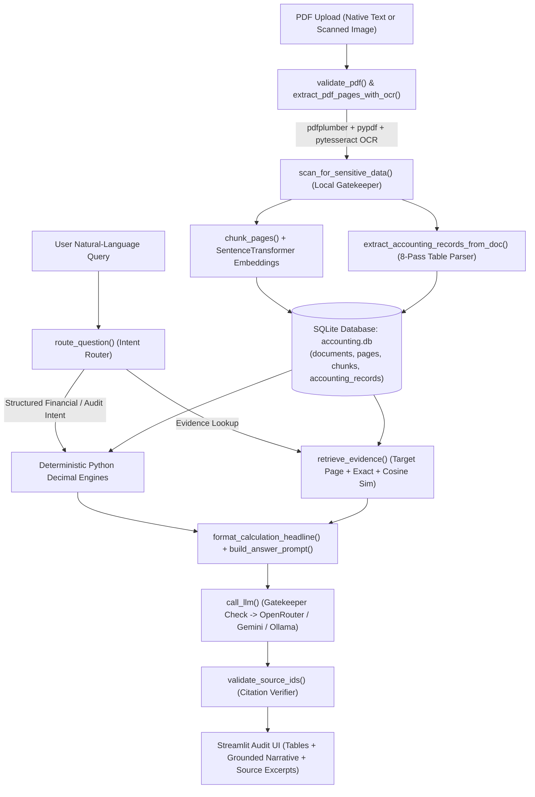

# 📑 Accounting Document Assistant

An evidence-grounded AI accounting assistant built in Python. Upload multi-page accounting PDFs—such as accounts receivable transaction books, customer open-item ledgers, invoices, cash receipt registers, credit note registers, and scanned statements—and query them in natural language.

Standard Retrieval-Augmented Generation (RAG) pipelines pass raw text chunks to a Large Language Model and rely on the model to perform arithmetic, reconcile balances, and track multi-page table state—an approach prone to floating-point rounding errors, double-counting, and hallucinated figures. **Accounting Document Assistant** solves this by pairing **multi-pass deterministic table extraction** and **Python `Decimal` financial engines** with **hybrid SQLite retrieval**, a **local sensitive-data gatekeeper**, and **citation-verified LLM synthesis**.

---

## ✨ Core Capabilities

- **Exact Financial Arithmetic (`Decimal`)**: Every monetary value is parsed, stored, and aggregated using Python's `decimal.Decimal` (`ROUND_HALF_UP` to `0.01`). Floating-point numbers (`float`) and LLM mental arithmetic are never used for financial totals.
- **Strict Multi-Currency Isolation**: Multi-currency ledgers (`AED`, `USD`, `EUR`, `GBP`, etc.) are computed and reported in isolated currency buckets. The system refuses to combine or convert currencies unless an explicit exchange rate is stated in the document.
- **8-Pass Table-Aware Accounting Extraction**: Automatically extracts and cross-links structured records across Customer Open-Item Ledgers, Invoice Detail & Price Reconciliation tables, Applied Cash Receipts Registers, Credit Note Registers, Unallocated Cash & Exception Registers, and Control Totals.
- **Accounting Policy Enforcement**:
  - **Gross vs. Net Exposure**: Distinguishes posted open invoice balances (where applied payments and credit notes are already deducted) from customer-level unallocated cash receipts (`Net Exposure = Gross Outstanding - Unallocated Cash`).
  - **Disputed Balances & Unverified Claims**: Tracks disputed amounts and unverified payment claims separately without artificially reducing posted open balances.
  - **Strict Aging & Overdue Classification**: Marks an invoice overdue only when its stated due date is strictly earlier than the reference date and its posted balance is positive (`> 0.00`). Invoices lacking a stated due date are kept in an unclassified audit bucket rather than guessed.
- **3-Tier PDF & OCR Ingestion**: Extracts structured tables and text from native PDFs via `pdfplumber` and `pypdf`, and automatically falls back to `2x` high-resolution page rendering (`pypdfium2`) + optical character recognition (`pytesseract`) on scanned image pages.
- **Hybrid Retrieval (Target Page + Exact Token + Dense Vector Search)**: Combines deterministic page-number targeting, exact identifier matching (`AR-0035`, `CN-0004`, `UC-001`), and cosine-similarity semantic search using offline `SentenceTransformer` embeddings.
- **Local Sensitive-Data Gatekeeper**: Deterministic keyword and regex scanner checks every extracted page and user query locally for secrets (`password`, `api_key`, `private_key`, credit card numbers, SSNs) and blocks outbound cloud API calls if sensitive data is present.
- **Multi-Provider LLM Support**: Works with **OpenRouter (Cloud)**, **Google Gemini (Cloud — Interactions API & `generateContent`)**, and **Local Ollama (100% Offline)** with automatic fallback.
- **Citation Verification**: Validates every `[S1]`, `[S2]` source reference in the LLM's output against retrieved evidence chunks and flags any unverified citation IDs.

---

## 🧠 Technology Stack & Architectural Reasoning

Every technology in this project was selected to address a specific failure mode of traditional document AI systems:

| Component / Technology | Role in System | Why This Technology Was Chosen |
| :--- | :--- | :--- |
| **Python `decimal.Decimal`** (`ROUND_HALF_UP`) | Financial parsing, reconciliation, & aggregation | IEEE 754 binary floating-point (`float`) cannot represent base-10 decimals like `0.10` exactly, causing penny drift across multi-row ledgers. LLMs also frequently hallucinate sums over 20+ items. `Decimal` guarantees exact base-10 cent precision matching accounting control totals. |
| **SQLite (`sqlite3` in WAL mode)** | Unified storage for documents, pages, tables, vector chunks, & ledger records | External vector databases (Pinecone, Chroma, Qdrant, Milvus) introduce server processes, port conflicts, or background daemon dependencies. Storing relational accounting records (`accounting_records`) alongside JSON-serialized embeddings (`chunks`) in a single WAL-mode SQLite file (`accounting.db`) provides ACID transactions, `ON DELETE CASCADE` integrity, zero external infrastructure, and sub-millisecond local queries. |
| **`pdfplumber` + `pypdf` + `pypdfium2` + `pytesseract`** | 3-tier PDF text, table, and OCR extraction pipeline | No single PDF library handles all accounting documents well: `pdfplumber` excels at reconstructing 2D bounding-box tables (`extract_tables()`) from native PDFs; `pypdf` provides fast stream validation, encryption checks, and text fallback; `pypdfium2` renders scanned pages to PIL images without requiring heavy OS-level Poppler binaries; and `pytesseract` performs local OCR when page text falls below 50 characters. |
| **`sentence-transformers` (`all-MiniLM-L6-v2`) + `NumPy`** | Local 384-dimensional dense vector embeddings & cosine similarity | `all-MiniLM-L6-v2` produces high-quality semantic embeddings in milliseconds on CPU while keeping model weights compact (~90 MB). Caching the model in `./local_model` eliminates network calls during ingestion and retrieval, and computing cosine similarity directly via `numpy.dot` over SQLite rows avoids native C++ index build issues. |
| **Deterministic Regex & Keyword Gatekeeper** | Pre-flight PII and credential DLP scanner | Using an LLM to check whether a document contains sensitive data requires sending that sensitive data to the LLM first—defeating the privacy boundary. A deterministic local regex/keyword scanner runs in microseconds with zero false negatives on defined patterns (PEM keys, card numbers, SSNs, credential keys) before any outbound socket opens. |
| **Direct `httpx` REST Clients (OpenRouter, Gemini, Ollama)** | LLM inference layer | Official provider SDKs often bundle heavy gRPC dependencies, background retry loops that freeze UI threads on rate limits, or macOS SSL certificate conflicts. Direct `httpx` REST calls provide explicit timeout control, SSL tolerance, transparent model fallback (`openrouter/auto`, `gemini-3.8-flash` → `gemini-2.5-flash`), and zero-dependency offline switching to local Ollama (`localhost:11434`). |
| **Streamlit (Single-File Architecture)** | Interactive audit UI, document scope manager, & debug inspector | Consolidating the ingestion pipeline, SQLite engine, financial calculators, and interactive chat UI into [`app.py`](app.py) keeps state management transparent and allows auditors to inspect raw evidence excerpts and JSON debug payloads directly alongside chat answers. |

---

## 🏗️ System Architecture



---

## 📁 Repository Structure

```text
accounting-document-assistant/
├── app.py                        # Complete single-file application (Ingestion, OCR, DB, RAG, Decimal Engines, UI)
├── test_app_integration.py       # End-to-end integration & accounting verification test suite (11 test stages)
├── accounting_ground_truth.json  # Ground-truth benchmark dataset (40 AR invoices, registers, 18 audit questions)
├── test_docs/                    # Sample PDF test suite
│   ├── complex_accounts_receivable_transaction_book.pdf  # 51-page multi-currency AR transaction book
│   ├── invoice_acme.pdf          # Standard single-invoice test PDF
│   ├── invoice_alpha.pdf         # Vendor invoice test PDF
│   ├── invoice_beta.pdf          # Multi-line invoice test PDF
│   ├── sensitive_invoice.pdf     # Test PDF containing credentials to trigger the Local Gatekeeper
│   └── statement_scan.pdf        # Scanned image PDF to test pypdfium2 + pytesseract OCR fallback
├── .streamlit/
│   └── config.toml               # Headless server & port (8501) configuration
├── .env.example                  # Template for OpenRouter & Google Gemini API keys
├── requirements.txt              # Python package dependencies
└── README.md                     # Documentation & code reference
```

*(Note: `accounting.db` and `./local_model` are automatically generated on first launch.)*

---

## 🔍 Codebase Reference (Part-by-Part Explanation)

All application logic resides in [`app.py`](app.py), structured into **9 logical sections**, accompanied by the automated verification suite in [`test_app_integration.py`](test_app_integration.py).

---

### Part 1: Configuration & Local Sensitive Data Gatekeeper (`app.py`, `Lines 50–108`)

Enforces a deterministic local security boundary before any page is stored or any prompt leaves the machine.

- **`SENSITIVE_KEYWORDS` & `SENSITIVE_PATTERNS` (`Lines 64–76`)**:
  - Defines whole-word credential/PII keywords (`password`, `passwd`, `secret_key`, `api_key`, `access_token`, `private_key`, `cvv`, `credit card`, `social security`, `ssn`, etc.).
  - Defines regex patterns for PEM private key headers (`-----BEGIN ... PRIVATE KEY-----`), 13–16 digit payment card numbers, SSNs (`\d{3}-\d{2}-\d{4}`), and inline key/secret assignments.
- **`scan_for_sensitive_data(text)` (`Lines 81–107`)**:
  - Scans input text using word-boundary regular expressions (`\b...\b`) and pattern matchers.
  - Returns `(has_sensitive_data: bool, reasons: List[str])`.
  - Executed during PDF ingestion (flagging `contains_sensitive_data = 1` in SQLite) and inside `call_llm()` prior to any network request.

---

### Part 2: SQLite Database Layer (`app.py`, `Lines 110–245`)

Manages schema creation, relational integrity, and persistent settings inside `accounting.db`.

- **`get_db_connection()` (`Lines 112–117`)**: Opens a connection to `accounting.db` with `PRAGMA foreign_keys = ON` and `PRAGMA journal_mode = WAL`.
- **`init_database()` (`Lines 119–209`)**: Creates the database schema:
  - **`documents`**: Stores `doc_id` (16-char SHA-256 hash), `filename`, `status` (`success`, `partial`, `ocr_required`, `invalid`), `total_pages`, `warnings` (JSON array), `contains_sensitive_data`, `sensitive_details`, and `uploaded_at`.
  - **`pages`**: Stores 1-based `page_number`, extracted `text`, `extraction_method` (`text_extraction` or `OCR (Tesseract)`), `contains_sensitive_data`, and `tables_json` (JSON-serialized 2D tables extracted by `pdfplumber`).
  - **`chunks`**: Stores `chunk_id`, `doc_id`, `doc_name`, `page_number`, `text`, and `embedding` (JSON-serialized float vector).
  - **`accounting_records`**: Unified ledger table storing structured financial entities across 6 `record_type`s (`invoice`, `payment`, `credit_note`, `unallocated_cash`, `claim`, `control_total`). Tracks `identifier`, `seller`, `customer`, `currency`, `invoice_date`, `due_date`, `due_date_source`, `original_total`, `applied_payment`, `applied_credits`, `posted_outstanding`, `unallocated_cash`, `disputed_amount`, `undisputed_amount`, `unverified_claim`, `payment_status`, `source_pages` (JSON list of page numbers), and `field_evidence` (JSON dict containing line items and price reconciliations).
  - **`invoices` (SQL View)**: Projects `record_type = 'invoice'` rows for legacy compatibility.
  - **`app_settings`**: Persists user configuration (`llm_provider`, selected model names, etc.).
- **`get_saved_setting(key, default)` & `set_saved_setting(key, value)` (`Lines 211–232`)**: Helper functions to read and write persistent settings in `app_settings`.
- **`clean_api_key(raw_key)` (`Lines 234–241`)**: Sanitizes API keys by stripping surrounding quotes, whitespace, and accidental `Bearer ` prefixes.

---

### Part 3: Offline Embedding Model Loader (`app.py`, `Lines 246–267`)

- **`get_embedding_model()` (`Lines 250–266`)**:
  - Cached across Streamlit reruns via `@st.cache_resource`.
  - Loads `SentenceTransformer` directly from `./local_model` if present on disk for instant offline startup.
  - If `./local_model` does not exist yet, downloads `all-MiniLM-L6-v2` once and saves it to `./local_model`.

---

### Part 4: PDF Validation, 3-Tier Extraction & Page-Aware Chunking (`app.py`, `Lines 269–521`)

- **`compute_file_hash(file_bytes)` (`Lines 271–273`)**: Generates a deterministic 16-character SHA-256 hex digest from file bytes to prevent duplicate indexing.
- **`validate_pdf(file_bytes, filename)` (`Lines 275–296`)**: Verifies the `%PDF-` header, checks `pypdf.PdfReader` for password encryption or structural corruption, and ensures the file has at least 1 page.
- **`extract_pdf_pages_with_ocr(file_bytes, filename, reader)` (`Lines 298–407`)**:
  - Iterates over each page (`1` to `total_pages`):
    1. **Tier 1 (`pdfplumber`)**: Extracts layout-accurate text (`extract_text()`) and structured tables (`extract_tables()`).
    2. **Tier 2 (`pypdf`)**: Falls back to `pypdf` if `pdfplumber` returns empty text.
    3. **Tier 3 (`pypdfium2` + `pytesseract` OCR)**: Triggered automatically when extracted text has fewer than `LOW_TEXT_PAGE_THRESHOLD` (50) characters. Renders the page at `scale=2` to a PIL image and runs Tesseract OCR.
  - Runs `scan_for_sensitive_data()` on every page and computes the overall document status (`success`, `partial`, or `ocr_required`).
- **`chunk_pages(pages_data, doc_id, doc_name, ...)` (`Lines 412–521`)**:
  - Splits each page's text into chunks (`target_chars=650`, `max_chars=900`, `overlap_chars=120`).
  - **Strict Page-Boundary Rule**: Chunks never span across two pages, ensuring every chunk maps to an exact 1-based `page_number` for citation auditing.
  - Splits along paragraph (`\n\n`) and line (`\n`) boundaries so table rows are never cut mid-line.

---

### Part 5: Multi-Provider LLM Engine (`app.py`, `Lines 526–952`)

- **`check_ollama_available()` & `call_ollama()` (`Lines 528–569`)**: Queries `http://localhost:11434/api/tags` to list local Ollama models and executes deterministic (`temperature: 0.0`) local inference via `/api/generate`.
- **`get_openrouter_config()`, `fetch_openrouter_models()`, & `call_openrouter()` (`Lines 590–756`)**:
  - Connects to `https://openrouter.ai/api/v1/chat/completions` over `httpx`.
  - Automatically retries with fallback models (`openrouter/auto`, `openrouter/free`) on transient HTTP errors (`400`, `404`, `429`, `502`, `503`).
  - Detects if a Google Gemini API key (`AIza...`) was pasted into the OpenRouter field and forwards the call to `call_gemini()`.
- **`get_gemini_config()` & `call_gemini()` (`Lines 758–917`)**:
  - Calls Google Gemini REST endpoints over `httpx`, trying the **Interactions API** (`/v1beta/interactions`) first for `gemini-3.8-flash` and falling back to `/v1beta/models/{model}:generateContent` across `gemini-3.8-flash`, `gemini-2.5-flash`, `gemini-2.0-flash`, and `gemini-1.5-flash`.
  - Detects if an OpenRouter key (`sk-or-...`) was pasted into the Gemini field and forwards to `call_openrouter()`.
- **`call_llm(prompt, system_prompt, json_mode)` (`Lines 919–951`)**:
  - Unified entry point for all LLM requests.
  - Runs `scan_for_sensitive_data()` on the combined prompt and raises a `PermissionError` before any network call if sensitive data is detected.

---

### Part 6: 8-Pass Deterministic Accounting Extractor & Ingestion Pipeline (`app.py`, `Lines 954–1595`)

- **Parsing Utilities (`Lines 956–994`)**:
  - `clean_decimal_string(val)`: Strips currency symbols/commas and quantizes numbers to `Decimal("0.01")` (`ROUND_HALF_UP`).
  - `normalize_identifier(raw)`: Uppercases IDs and normalizes Unicode hyphens (`\u2010`–`\u2015`, `\u2212`) to ASCII `-`.
  - `parse_date_string(val)`: Parses multiple date formats into `datetime.date`.
- **`extract_accounting_records_from_doc(doc_id, doc_name, pages_data)` (`Lines 996–1481`)**:
  - **Pass 1 (Global Seller Identification)**: Identifies the issuing vendor/seller across document headers.
  - **Pass 2A (Customer Open-Item Ledgers)**: Parses multi-page customer open-item tables, preserving customer context across continuation pages, rejecting non-invoice header/total rows, and recording `original_total`, `applied_payment`, `applied_credits`, `posted_outstanding`, and `due_date`.
  - **Pass 2B (Invoice Detail & Reconciliation Pages)**: Extracts 8-column line-item tables (`item`, `qty`, `unit_price`, `gross`, `discount`, `net`, `tax`, `total`), price reconciliation tables, and disputed balance notes.
  - **Pass 2C (Applied Cash Receipts Register)**: Parses receipt rows (`RC-####`) and links applied cash to target invoices.
  - **Pass 2D (Credit Note Register)**: Parses credit notes (`CN-####`), linking credit amounts to target invoices while flagging that they are already reflected in open ledger balances.
  - **Pass 2E (Unallocated Cash & Exception Register)**: Extracts customer-level unallocated cash items (`UC-001`, `UC-002`, `UC-003`) and unverified payment claims (`CLM-0035`).
  - **Pass 2F (Customer & Currency Control Totals)**: Extracts control total rows (`CTRL-...`) for reconciliation checks.
  - **Pass 3 (Single-Invoice Fallback)**: Regex-based parser for standalone single-page invoices without ledger registers.
- **`index_document(filename, file_bytes, embedding_model)` (`Lines 1486–1587`)**: Executes the end-to-end ingestion workflow and commits all extracted pages, chunks, embeddings, and accounting records atomically to SQLite.
- **`delete_document(doc_id)` (`Lines 1589–1594`)**: Deletes a document and cascades removal across all child tables.

---

### Part 7: Hybrid Evidence Retrieval (`app.py`, `Lines 1597–1716`)

- **`retrieve_evidence(query, selected_doc_ids, embedding_model, top_k, exact_lookup, target_pages)` (`Lines 1599–1716`)**:
  Retrieves supporting text chunks from SQLite in three prioritized stages:
  1. **Target Source Pages**: Pulls chunks directly from the `source_pages` identified by the deterministic calculation engine.
  2. **Exact Token Matching**: Matches alphanumeric identifiers in the query (e.g., `AR-0035`) against full page text.
  3. **Semantic Vector Search**: Encodes the query with `SentenceTransformer` and ranks all remaining chunks in active documents by cosine similarity.
  - Labels returned evidence blocks sequentially (`S1`, `S2`, ..., `Sk`).

---

### Part 8: Deterministic Financial Engines, Intent Router & Citation Verifier (`app.py`, `Lines 1719–2829`)

- **`calculate_customer_exposure()` (`Lines 1721–1842`)**: Computes **Gross Outstanding**, **Less Unallocated Cash**, and **Net Exposure** per currency for a specified customer.
- **`calculate_receivables_by_currency()` (`Lines 1844–1927`)**: Computes **Original Face Total**, **Applied Cash**, **Applied Credits**, **Gross Outstanding**, **Unallocated Cash**, and **Net Exposure** per currency across all active documents.
- **`evaluate_overdue_invoices()` (`Lines 1929–2001`)**: Categorizes invoices as of the reference date (`2026-11-06`) into `confirmed_overdue` (`due_date < as_of_date` and `posted_outstanding > 0`), `settled` (`posted_outstanding == 0`), `unclassified_unknown_due_date`, and `not_yet_due`.
- **`find_highest_invoice()` (`Lines 2003–2060`)**: Identifies both the **Highest Original Face Value** invoice and the **Highest Posted Outstanding Balance** invoice per currency.
- **`lookup_single_invoice()` (`Lines 2062–2109`)**: Retrieves the full multi-page lifecycle, line items, price reconciliation, dispute notes, and unverified claims for a specific record ID.
- **`calculate_customer_totals()` & `calculate_vendor_totals()` (`Lines 2111–2187`)**: Aggregates total invoiced face values for a specific customer or vendor by currency.
- **Audit Calculators (`Lines 2189–2397`)**:
  - `calculate_vendor_customer_counterparties()`: Lists distinct vendors and customers.
  - `calculate_record_counts()`: Counts unique logical invoices and total priced line items.
  - `calculate_disputed_balances()`: Audits all disputed invoice balances and states their accounting treatment.
  - `calculate_unknown_due_dates()`: Audits invoices missing a stated due date.
  - `calculate_highest_line_items()`: Scans all line-item tables to find the highest-priced individual line item per currency.
  - `build_ledger_summary_for_prompt()`: Formats a compact full-ledger overview for high-context cloud models.
- **`route_question(question, selected_doc_ids)` (`Lines 2402–2505`)**: Classifies user queries into 16 deterministic intents (including ambiguity clarification requests, currency combination refusals, missing bank account checks, and financial calculation routes).
- **`format_calculation_headline(calc_data)` (`Lines 2507–2757`)**: Formats deterministic calculation dictionaries into Markdown summary tables and mathematical breakdowns.
- **`build_answer_prompt(...)` (`Lines 2762–2812`)**: Assembles the grounded LLM prompt with strict anti-hallucination rules, verified `Decimal` calculation JSON, ledger context, and `[S1]..[Sk]` evidence passages.
- **`validate_source_ids(answer, valid_source_ids)` (`Lines 2814–2828`)**: Verifies every `[S#]` tag in the generated answer against retrieved evidence IDs and rewrites any invalid reference to `[Unverified Source S#]`.

---

### Part 9: Streamlit Audit Interface (`app.py`, `Lines 2832–3434`)

- **`render_app()` (`Lines 2834–3434`)**:
  - **AI Engine & Model Settings (`Lines 2873–3034`)**: Sidebar controls to select between OpenRouter, Google Gemini, and Local Ollama, save/test API keys, and choose models.
  - **PDF Upload & Security Status (`Lines 3037–3100`)**: Multi-file uploader displaying per-document page counts, extraction status badges, OCR warnings, and sensitive-data lock indicators.
  - **Search Scope & Document Management (`Lines 3103–3145`)**: Multiselect scope filter and document deletion controls.
  - **Interactive Chat & Audit View (`Lines 3149–3431`)**: Renders deterministic Markdown tables, cited narrative explanations, expandable raw source excerpts (`🔍 View Supporting Excerpts`), and a full JSON inspection drawer (`🛠️ Processing & Debug Details`).

---

### Part 10: End-to-End Integration Test Suite ([`test_app_integration.py`](test_app_integration.py))

[`test_app_integration.py`](test_app_integration.py) verifies the ingestion, extraction, routing, and `Decimal` calculation engines against [`accounting_ground_truth.json`](accounting_ground_truth.json) across 11 automated test stages:
1. **Receivables by Currency**: Verifies exact AED and USD face totals, applied cash, credits, gross outstanding, unallocated cash, and net exposure.
2. **Harborline Exposure**: Verifies customer-level gross, unallocated, and net exposure in AED and USD.
3. **Meridian Exposure**: Verifies customer-level gross, unallocated, and net exposure in AED and USD.
4. **Overdue Evaluation**: Verifies `20` confirmed overdue invoices totaling `AED 100,599.27` and `USD 28,779.49` as of `2026-11-06`, while keeping `AR-0013` unclassified and `AR-0028` settled.
5. **Highest Invoice Breakdown**: Verifies highest face value vs. highest open balance per currency (`AR-0022`, `AR-0040`, `AR-0005`).
6. **Single-Invoice Lookups**: Verifies exact lifecycle breakdowns and multi-page citations (`[2, 40, 49, 50]`) for `AR-0035`, `AR-0003`, and `AR-0021`.
7. **18-Question Intent Routing**: Verifies that all 18 benchmark audit questions route to their expected calculation engines.
8. **Citation Validation**: Confirms valid `[S1]`, `[S2]` tags pass and fabricated `[S99]` tags are rewritten to `[Unverified Source S99]`.
9. **Headline Markdown Formatting**: Verifies rendered Markdown tables contain exact figures.
10. **Document Scope Filtering**: Confirms empty document scopes return zeroed structures without cross-document leakage.
11. **Dynamic Counterparty, Count, Dispute, Unknown-Due, and Line-Item Audits**: Verifies `40` unique invoices, `160` priced line items, disputed balances (`AR-0007`, `AR-0019`, `AR-0035`), unknown due dates (`AR-0013`, `AR-0028`), and highest individual line items.

---

## 🚀 Getting Started

### 1. Prerequisites

- **Python 3.10+**
- **Tesseract OCR** *(optional, required only for scanned image-based PDFs)*:
  - macOS: `brew install tesseract`
  - Ubuntu/Debian: `sudo apt-get install tesseract-ocr`

### 2. Clone & Install Dependencies

```bash
git clone https://github.com/Nikunj-Gupta-1/accounting-document-assistant.git
cd accounting-document-assistant

python3 -m venv .venv
source .venv/bin/activate
pip install -r requirements.txt
```

### 3. Configure API Keys (Optional — Can Also Be Set in the Sidebar)

Copy `.env.example` to `.env` and add an API key, or use Local Ollama for offline inference:

```bash
cp .env.example .env
```

```env
# Option A: OpenRouter (Cloud)
OPENROUTER_API_KEY=sk-or-v1-...
OPENROUTER_MODEL=openrouter/auto

# Option B: Google Gemini (Google AI Studio)
GEMINI_API_KEY=AIzaSy...
GEMINI_MODEL=gemini-3.8-flash
```

### 4. Run the Application

```bash
streamlit run app.py
```

Open `http://localhost:8501` in your browser, upload any PDF from `test_docs/`, and ask questions in natural language.

### 5. Run the Integration Test Suite

```bash
python3 test_app_integration.py
```
